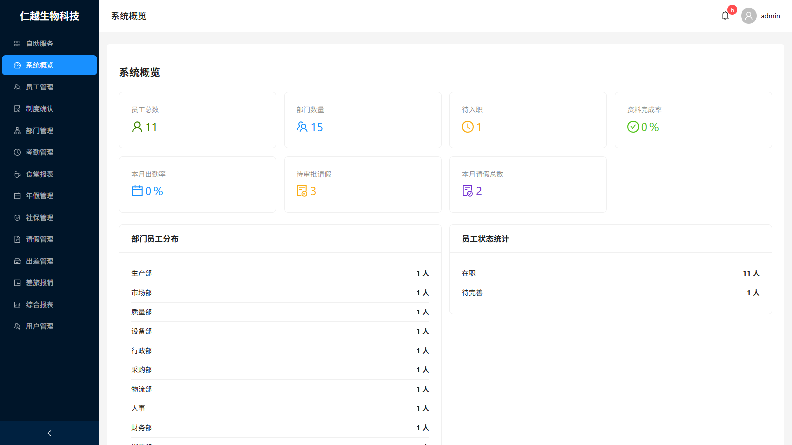
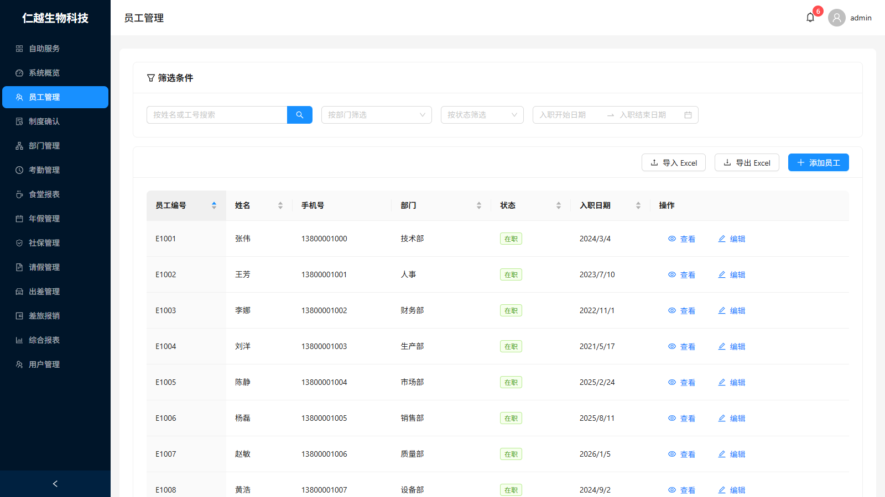
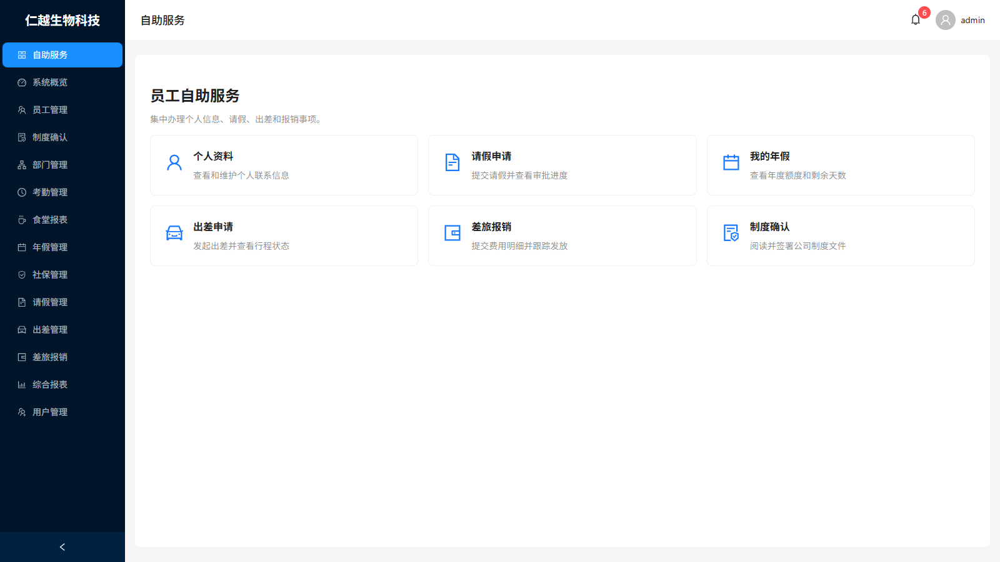

<p align="center">
  
</p>

<h1 align="center">仁越生物科技人事管理平台</h1>

<p align="center">
  一套给中小企业 HR 用的人事系统：员工档案、考勤、请假、年假、社保、出差报销和制度签署放在一个地方。
</p>

<p align="center">
  <a href="https://github.com/YCRenyue/hrsystem/actions/workflows/ci.yml"></a>
  <a href="LICENSE"></a>
</p>

<p align="center">
  中文 | <a href="#english">English</a>
</p>

---

## 当前状态

截至 2026 年 10 月，系统已部署在阿里云 ECS 测试服务器上，`main` 分支合并后由 GitHub Actions 自动构建并发布。目前在做交付 HR 试用前的回归测试，测试记录见 [docs/test-cases](docs/test-cases/README.md)。

可以用的：

- 员工档案：在线录入、花名册 Excel 导入导出、办理离职（员工不删除，只停用登录）
- 考勤：直接导入打卡机的刷卡记录，自动判断迟到、早退、缺卡，合并已批准的请假，生成考勤报表和异常提醒
- 食堂：按刷卡时间统计午餐、晚餐人数，不在饭点的刷卡进入待复核
- 请假：部门经理和 HR 两级审批，批准后自动扣年假并写入考勤
- 年假按工龄自动生成和结转；社保公积金按配置比例计算
- 出差和差旅报销：部门审批、HR 复核、财务发放
- 制度确认：规章制度分页阅读后签署、培训承诺函、劳动合同在线签署
- 员工自助服务、站内通知、综合报表
- 五种角色（管理员、HR、部门经理、财务、员工），按全部 / 本部门 / 本人限制数据范围

还没做或没做完的：

- 智能问答助手（尚未开始）
- 钉钉扫码登录和组织架构同步（目前只接了消息推送）
- 节假日和调休日历，非工作日的打卡暂时都进待复核
- 劳动合同正文还是草案，上线前需要法务审定
- 前端自动化测试很少，主要靠手工回归

详细进度在 [requirement.md](requirement.md)。

## 页面截图

截图来自本地演示库，人员和手机号均为虚构数据。

| 登录 | 系统概览 |
| --- | --- |
|  |  |
| **员工管理** | **员工自助服务** |
|  |  |

HR 操作手册（带截图）：[docs/user-guide/HR-USER-GUIDE.md](docs/user-guide/HR-USER-GUIDE.md)

## 技术栈

| 部分 | 选型 |
| --- | --- |
| 前端 | React 19、TypeScript、Ant Design 5 |
| 后端 | Node.js 20、Express 5、Sequelize 6 |
| 数据库 | MySQL 8.0 |
| 文件存储 | 阿里云 OSS |
| 部署 | Docker、阿里云容器镜像服务 ACR、ECS，GitHub Actions 发布 |

身份证号、手机号、银行卡号等敏感字段用 AES-256 加密存储，另存哈希用于查询；没有权限的账号看到的是脱敏后的值。增删改员工、导出、改权限等操作都会写入 `operation_logs` 审计表。系统统一使用北京时间。

## 本地运行

需要 Node.js 20 和 MySQL 8.0。

```bash
git clone https://github.com/YCRenyue/hrsystem.git
cd hrsystem
npm run install:all

# 配置数据库连接、JWT_SECRET、ENCRYPTION_KEY（32 位）等
cp backend/.env.example backend/.env

npm run db:migrate   # 建表，包含全部增量迁移
npm run db:seed      # 默认部门和管理员账号

npm run dev          # 前端 http://localhost:3000，后端 http://localhost:3001
```

种子脚本创建的管理员首次登录后会被要求修改密码。管理员用户名和初始密码可以用 `SEED_ADMIN_USERNAME`、`SEED_ADMIN_PASSWORD` 覆盖，生产环境请务必设置。

常用命令：

```bash
npm test               # 前后端测试
npm run lint           # 前后端 ESLint
cd frontend && npx tsc --noEmit
```

## Docker 部署

```bash
cp docker/.env.example docker/.env   # 填写数据库密码和各项密钥
npm run docker:build
npm run docker:up
docker exec -it hr_backend npm run db:migrate
docker exec -it hr_backend npm run db:seed
```

线上环境使用 `docker/docker-compose.production.yml`，由 `.github/workflows/deploy.yml` 构建镜像推送到阿里云 ACR 后，在 ECS 上拉取并启动，健康检查失败会自动回滚。

## 目录结构

```
backend/    Express API：路由、控制器、服务、Sequelize 模型和迁移
frontend/   React 前端
docker/     Docker Compose 配置
docs/       客户需求、测试记录、HR 操作手册
sample_data/ 各类导入模板（不含真实员工数据）
```

## 文档

- [requirement.md](requirement.md)：开发进度
- [docs/ProjectRequirement.md](docs/ProjectRequirement.md)：客户原始需求
- [docs/test-cases](docs/test-cases/README.md)：线上测试记录
- [docs/user-guide](docs/user-guide/HR-USER-GUIDE.md)：HR 操作手册
- [CLAUDE.md](CLAUDE.md)：代码规范和架构说明

## 许可证

[MIT](LICENSE)

---

<a id="english"></a>

## English

An HR system for small and mid-sized companies. Employee records, attendance, leave, annual leave, social insurance, business trips, expense claims and policy sign-off live in one place. The UI is in Chinese.

### Status

As of October 2026 the system runs on an Alibaba Cloud ECS test server. Every merge to `main` is built and deployed by GitHub Actions. We are doing regression testing before handing it to the HR team; test records are in [docs/test-cases](docs/test-cases/README.md) (Chinese).

Working today:

- Employee records: online entry, roster import and export via Excel, offboarding (employees are never deleted, their login is disabled)
- Attendance: imports raw punch records from the time clock, flags late arrival, early leave and missing punches, merges approved leave, and produces reports and absence alerts
- Canteen: counts lunch and dinner from punch times; punches outside meal hours go to a review queue
- Leave: two-step approval (department manager, then HR); approval deducts annual leave and updates attendance
- Annual leave is generated and carried over by length of service; social insurance and housing fund are calculated from configured rates
- Business trips and expense claims: department approval, HR review, finance payout
- Policy sign-off: paged reading of company rules before signing, training pledge, online employment contract signing
- Employee self-service, in-app notifications, combined reports
- Five roles (admin, HR, department manager, finance, employee) with data scoped to all, own department, or self

Not done yet:

- AI Q&A assistant (not started)
- DingTalk login and org sync (only DingTalk messaging is wired up)
- Public holiday and make-up workday calendar; punches on non-working days all go to review for now
- The employment contract text is a draft and needs legal review before go-live
- Very little automated frontend testing; we rely on manual regression

Detailed progress is tracked in [requirement.md](requirement.md) (Chinese).

### Screenshots

Taken from a local demo database. All names and phone numbers are made up.

| Login | Overview |
| --- | --- |
|  |  |
| **Employees** | **Self-service** |
|  |  |

### Tech stack

| Part | Choice |
| --- | --- |
| Frontend | React 19, TypeScript, Ant Design 5 |
| Backend | Node.js 20, Express 5, Sequelize 6 |
| Database | MySQL 8.0 |
| File storage | Alibaba Cloud OSS |
| Deployment | Docker, Alibaba Cloud Container Registry, ECS, released by GitHub Actions |

ID numbers, phone numbers and bank card numbers are stored AES-256 encrypted, with a separate hash for lookups. Accounts without permission see masked values. Creating, editing or exporting employees and changing permissions are written to the `operation_logs` audit table. Everything runs in Beijing time (UTC+8).

### Run locally

Requires Node.js 20 and MySQL 8.0.

```bash
git clone https://github.com/YCRenyue/hrsystem.git
cd hrsystem
npm run install:all

# Set the database connection, JWT_SECRET, ENCRYPTION_KEY (32 chars), etc.
cp backend/.env.example backend/.env

npm run db:migrate   # creates all tables, including incremental migrations
npm run db:seed      # default departments and the admin account

npm run dev          # frontend http://localhost:3000, backend http://localhost:3001
```

The seeded admin must change its password on first login. Set `SEED_ADMIN_USERNAME` and `SEED_ADMIN_PASSWORD` to override the defaults, and always set them in production.

Common commands:

```bash
npm test               # frontend and backend tests
npm run lint           # ESLint for both
cd frontend && npx tsc --noEmit
```

### Docker

```bash
cp docker/.env.example docker/.env   # fill in database password and secrets
npm run docker:build
npm run docker:up
docker exec -it hr_backend npm run db:migrate
docker exec -it hr_backend npm run db:seed
```

Production uses `docker/docker-compose.production.yml`. `.github/workflows/deploy.yml` builds the images, pushes them to Alibaba Cloud Container Registry, then pulls and starts them on ECS, rolling back automatically if the health check fails.

### Layout

```
backend/    Express API: routes, controllers, services, Sequelize models and migrations
frontend/   React app
docker/     Docker Compose files
docs/       Client requirements, test records, HR user guide
sample_data/ Import templates (no real employee data)
```

### License

[MIT](LICENSE)
