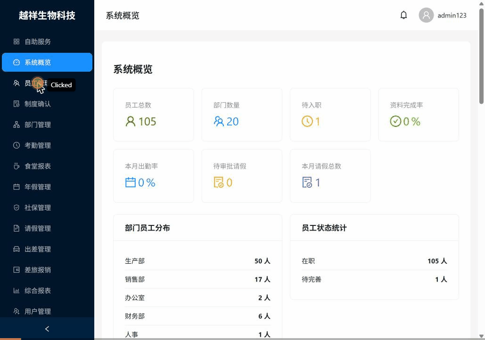
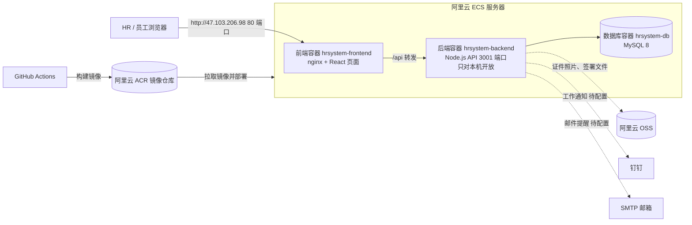
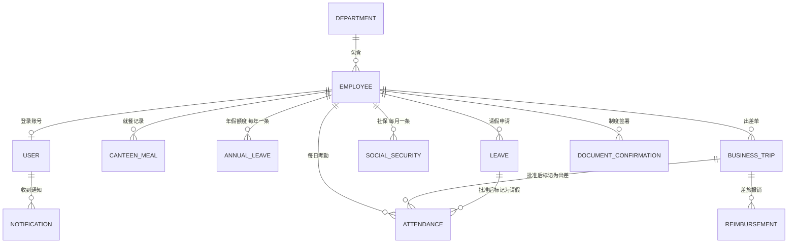
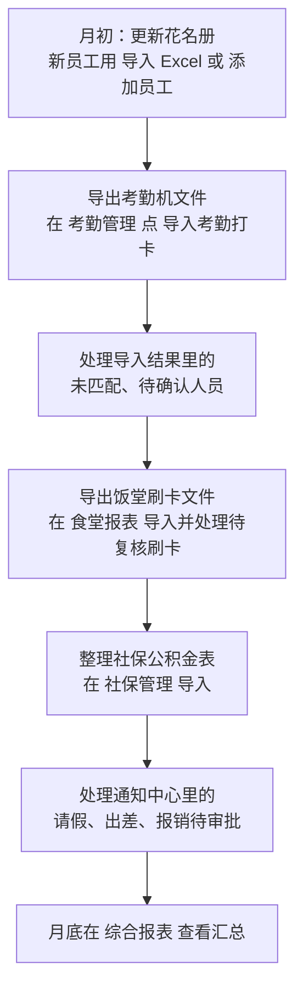
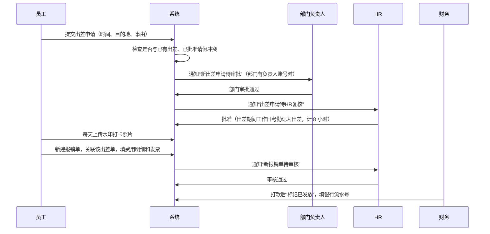
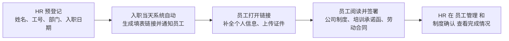
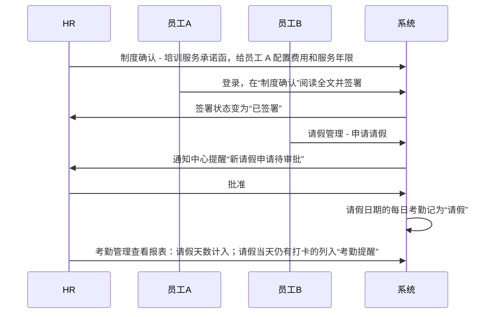

# 仁越生物科技人事管理平台 HR 使用手册

- 测试访问地址：http://47.103.206.98
- 适用对象：HR 管理员、超级管理员
- 版本：2026-10-28，对应部署 #87
- 本手册里的截图都来自云上环境的实际操作，样例数据以花名册中的员工和测试出差单（BT202610220001）为例
- 系统内所有时间统一为北京时间

操作演示（系统概览、按工号查员工、员工详情、考勤、食堂、出差和报销详情）：

---

## 1. 系统能做什么

| 模块 | 用途 | 数据从哪里来 |
|------|------|------|
| 员工管理 | 员工档案、证件资料、在职状态、办理离职 | 手工新增，或导入在职花名册 Excel |
| 部门管理 | 部门名称、编码、人数 | 手工维护；导入花名册时遇到新部门会自动建 |
| 考勤管理 | 每日打卡、迟到、早退、缺卡、工作时长、加班统计 | 导入考勤机导出的 xls（读取其中的“刷卡记录”表） |
| 食堂报表 | 中餐、晚餐就餐人次 | 导入饭堂刷卡机导出的 xls（读取其中的“刷卡记录”表） |
| 年假管理 | 每人每年的应休、已休、结转、剩余 | 手工新增或 Excel 导入 |
| 请假管理 | 请假申请与审批 | 员工申请、HR 代员工申请，或 HR 用 Excel 导入 |
| 社保管理 | 每月社保、公积金个人和公司缴纳 | 手工添加或 Excel 导入 |
| 出差管理 | 出差申请、审批、水印打卡 | 提交申请，部门负责人 / HR 审批 |
| 差旅报销 | 关联出差单报销，审核、发放 | 提交报销，HR 审核，财务标记发放 |
| 制度确认 | 公司制度、培训承诺函、劳动合同的电子签署 | 员工阅读后签署，HR 查看状态 |
| 通知中心 | 待审批提醒 | 系统自动生成 |
| 综合报表 | 假期、考勤、入离职报表 | 汇总以上数据 |
| 用户管理 | 账号、角色、数据范围、重置密码 | 超级管理员维护 |

### 角色

| 角色 | 能做什么 |
|------|------|
| 超级管理员（admin） | 全部功能，包括用户和权限 |
| HR 管理员（hr_admin） | 员工、部门、考勤、假期、社保、报表等人事功能；出差 HR 复核；报销审核 |
| 部门经理（department_manager） | 查看和审批本部门数据；出差、请假的部门审批 |
| 财务（finance） | 报销发放 |
| 员工（employee） | 自助服务：查看和完善个人信息、请假、出差、报销、签署制度 |

---

## 2. 系统架构

说明：

- HR 只需要用浏览器打开 http://47.103.206.98，不用安装任何软件
- 身份证号、手机号、银行卡、姓名在数据库里都是加密存储的，只有有权限的账号才能看到明文
- 每次开发人员合并代码后，通过 GitHub Actions 自动构建并部署到服务器，数据库数据不会被清空
- 服务器、数据库和后端程序统一使用北京时间，打卡、出差、报销的时间都按北京时间保存和计算

---

## 3. 数据之间的关系

几条要记住的规则：

1. **先有员工，再有其他数据**。考勤、食堂、年假、社保、请假都挂在员工名下，所以每月先导花名册（或确认员工都已录入），再导其他表
2. **年假、社保、请假按“员工编号”匹配**，比如 RH-0001
3. **考勤和食堂打卡按“工号对照表”或“姓名”匹配**，因为考勤机和饭卡机里的工号和公司编号不是一套。对不上的人会在导入结果里列出来
4. **报销必须关联一张已批准的出差单**
5. **请假、出差批准后会改写对应日期的考勤**，以后重新导入打卡也不会把它们改回去（见 8.3 和 13.3）

---

## 4. 日常工作流程

### 4.1 每月例行工作

### 4.2 出差到报销

部门没有部门负责人账号时，出差申请直接进入 HR 审批。

### 4.3 新员工入职

入职通知优先通过钉钉工作通知发送，没有钉钉账号时改发邮件。员工既没有绑定钉钉也没有填邮箱时收不到通知，需要 HR 线下告知。

系统每天自动执行的提醒：

| 时间 | 内容 |
|------|------|
| 每天 09:00 | 检查当天入职的员工，发送填表通知；检查 30 天内到期的劳动合同 |
| 每天 10:00 | 入职前 3 天提醒 |
| 每天 08:00 | 培训提醒 |
| 每周一 09:00 | 入职满一周的欢迎消息 |

### 4.4 端到端样例：承诺函签署、请假与考勤

下面是一次完整的演示流程，录屏和截图在 [employee-flow](employee-flow/README.md) 目录：

1. **HR 配置承诺函**：见 14 章“培训服务承诺函”。配置后员工的铃铛会收到“待签署”提醒，点开即进入“制度确认”签署
2. **员工 A 签署**：员工首次登录要先修改密码，然后在“制度确认”打开培训服务承诺函，读到底后签名提交
3. **员工 B 请假**：员工在“请假管理”点“申请请假”，填写类型、日期、天数和原因
4. **HR 审批**：通知中心或请假管理里点“批准”
5. **查看考勤**：考勤管理页的请假天数会加上这次请假；如果请假当天又导入了打卡，会出现在“考勤提醒”里（见 8.6）

---

## 5. 登录与修改密码

1. 打开 http://47.103.206.98，输入用户名和密码，点“登录”
2. 第一次登录，或管理员重置过密码后，系统会强制要求修改密码
3. 连续输错 5 次密码，账号会被锁 30 分钟

登录后默认进入“系统概览”：

---

## 6. 部门管理

**新增部门**：部门管理，点“添加部门”，填部门名称和部门编码（例如 技术部 / DEPT_05），点“创建”。编码不能重复。

**编辑**：点该行“编辑”，改完点“更新”。

**删除**：点“删除”，在确认框里点“确定”。删除不可恢复。

> 部门名称里带“生产”二字的部门（如“生产部”）会按生产部的作息计算考勤（07:30 上班），改名时请注意，见 8.2。

---

## 7. 员工管理

### 7.1 导入花名册（推荐）

适用于第一次建档，或批量新增员工。

1. 员工管理，点“导入 Excel”，选择**在职**花名册文件
2. 系统先显示**导入预览**：总行数、可导入数、有问题的行和原因。预览不会写入任何数据
3. 确认无误后点“确认导入”

**样例**：导入 `花名册.xlsx`，105 行全部可导入：

导入完成后页面顶部提示“导入完成：成功 105 条”。

**花名册格式要求**（直接用公司现有的“在职花名册”格式即可，第一行可以是标题）：

| 列名 | 必填 | 样例 | 说明 |
|------|------|------|------|
| 公司编号 | 是 | RH-0001 | 员工编号，不能重复 |
| 姓名 | 是 | 马达 | |
| 身份证号码 | 建议 | 320925197112246754 | 系统会加密保存 |
| 出生日期 | 否 | 19711224 | |
| 性别 | 否 | 男 | |
| 联系电话 | 建议 | 13651590963 | |
| 入职时间 | 建议 | 2006/10/1 | Excel 日期格式即可 |
| 部门 | 建议 | 销售部 | 部门不存在时会自动新建 |
| 岗位 | 否 | 销售经理 | |
| 状态 | 否 | 在职 | 空着默认在职 |

注意：

- 同一个工号再导一次会被跳过，并提示“员工编号已存在”：

  

- **不能导入离职花名册**。标题含“离职”的表会整体拒收，状态写“离职”的行会列为错误行。员工离职请用 7.5 的“办理离职”
- 部门名称会去掉空格和末尾的“部”再匹配，所以“人事”和“人事部”算同一个部门；其他写法不同的名称仍会新建部门，导入前请对一下

### 7.2 手工新增员工

员工管理，点“添加员工”，带红色星号的是必填项：员工编号、姓名、性别、入职日期、部门、职位、雇佣类型。邮箱是选填项（很多员工没有邮箱），填写时会校验格式。保存后可以再上传身份证正反面、银行卡和毕业证书。

### 7.3 查找员工

在搜索框输入**姓名**（可以只输一部分）或**员工编号**，按回车或点放大镜搜索。也可以按部门、状态、入职日期筛选。

**样例**：输入“王”，找到 4 名姓王的员工：

### 7.4 查看和编辑

点“查看”进入员工详情，可以看到基本信息、联系方式、就职信息、证件资料和制度签署状态；点“编辑信息”修改。

### 7.5 办理离职

员工**不能删除**，只能标记离职。在员工详情右上角点“办理离职”，填写离职日期。系统会：

- 把员工状态改为“离职”，记录离职日期
- 停用该员工的登录账号
- 结算年假

离职员工的历史考勤、请假、报销等记录都会保留。

---

## 8. 考勤管理

### 8.1 导入考勤打卡

1. 从考勤机导出考勤文件（xls）。**导出时要包含“刷卡记录”这张表**，系统按它里面每个人每天的全部原始打卡时间计算考勤
2. 考勤管理，点“导入考勤打卡”，选择文件
3. 等导入结果弹窗出来，看“匹配员工”“未匹配员工”“待确认”和“提醒”

**样例**：导入 `考勤表贸易.xls`（2026-03-01 至 03-23）：

导入结果里各项的含义：

| 项目 | 含义 | HR 要做什么 |
|------|------|------|
| 匹配员工 | 打卡机里的人对上了系统里的员工 | 无 |
| 未匹配员工 | 打卡机里的姓名在系统里找不到（错字、离职、劳务工） | 在“工号对照表”里点选对应员工，或修正姓名后重新导入 |
| 待确认 | 同名的人有多个，系统不猜 | 在“工号对照表”里指定 |
| 未导入日期 | 导出当天及之后的数据不完整，不导入 | 下次导出包含这一天的文件再导入 |
| 机器旷工提醒 | 打卡机汇总的旷工天数明显多于实际没打卡的天数（多见于每天只打 2 次卡的生产部） | 建议在打卡机里给生产部设“每天 2 次”的班次 |
| 离职后仍有打卡 | 员工离职日期之后还有打卡，照常导入并单独列出 | 核实是否离职日期填错或他人代打卡 |
| 保留手工记录 | 当天已有 HR 手工录入的考勤，导入不覆盖 | 无 |

**工号对照表**：考勤机、饭卡机里的工号和公司编号（RH-xxxx）不是一套，两台机器之间也不一样。点“工号对照表”可以维护“哪台机器 + 机器工号 → 员工”，导入时先按对照表匹配，没有对照才按姓名匹配。对照建立后下次导入自动生效。

导入后的统计和迟到、早退排行：

### 8.2 公司作息

按《盐城仁越公司管规制度—2026》第二条：

| 时段 | 适用日期 | 上午 | 下午 |
|------|------|------|------|
| 夏令时 | 5 月 1 日至 9 月 30 日 | 08:00-11:30 | 14:00-18:30 |
| 冬令时 | 10 月 1 日至次年 4 月 30 日 | 08:00-11:30 | 13:30-18:00 |
| 生产部 夏令时 | 5 月 1 日至 9 月 30 日 | 07:30-11:30 | 14:00-18:00 |
| 生产部 冬令时 | 10 月 1 日至次年 4 月 30 日 | 07:30-11:30 | 13:30-18:00 |

- 是否按生产部作息，看员工所在部门的名称里有没有“生产”二字
- 周一到周五是工作日，周六、周日是休息日

### 8.3 每日考勤怎么算

系统对每个人每天的打卡按以下顺序处理：

**第 1 步：整理打卡**

- 5 分钟内的重复打卡只算一次（例：07:13、07:14 算一次）
- 当天最早一次打卡 = 上班，最晚一次 = 下班
- 11:00-12:30 之间的打卡算“午休下班”，12:30-14:30 之间的打卡算“午休上班”
- 其余中间的打卡（如外出）记在备注里的“额外打卡”，只备查，不影响结果

**第 2 步：判断状态**

| 状态 | 条件 |
|------|------|
| 周末 | 周六、周日。不算迟到早退，打卡时长全部算加班 |
| 缺勤 | 工作日全天没有打卡，也没有请假、出差 |
| 缺卡 | 工作日只打了 1 次卡（缺上班卡或缺下班卡）。午休两次没打不算缺卡 |
| 迟到 | 迟到分钟数大于 0 |
| 早退 | 不迟到，但早退分钟数大于 0 |
| 正常 | 以上都不是 |
| 请假 / 出差 | 请假或出差审批通过后写入，导入打卡不会改掉（见 8.4） |

一天既迟到又早退时，状态显示“迟到”，迟到和早退的分钟数都会记录。

**第 3 步：迟到、早退分钟数**

- 迟到 = 上午第一次打卡晚于上班时间的分钟数 + 午休上班卡晚于下午上班时间的分钟数
- 早退 = 最后一次打卡早于下班时间的分钟数
- 目前没有宽限时间，晚 1 分钟也算迟到

**第 4 步：工作时长和加班时长**（单位小时，保留 1 位小数）

- 工作时长 = 最早到最晚打卡之间，落在上午、下午两个上班时段内的时长。只看最早和最晚两次打卡，午休时间不计入。正常出满勤是 8 小时（生产部冬令时 8.5 小时）
- 工作日加班 = 下班时间之后的时长（最晚一次打卡减去下班时间）
- 周末加班 = 最早到最晚打卡的全部时长，扣除午休时段
- 当天少于 2 次打卡，工作时长和加班都记 0

**计算样例**（3 月为冬令时）：

| 员工 / 日期 | 打卡 | 结果 |
|------|------|------|
| 行政员工，工作日 | 07:52、11:35、13:28、19:05 | 正常；工作时长 3.5 + 4.5 = 8.0 小时；加班 19:05 - 18:00 = 1.1 小时 |
| 生产部员工，工作日 | 07:40、17:30 | 迟到 10 分钟、早退 30 分钟，状态“迟到”；工作时长 3.8 + 4.0 = 7.8 小时；加班 0 |
| 行政员工，工作日 | 08:05、11:31、14:10、18:00 | 迟到 5 + 40 = 45 分钟（下午 13:30 上班），状态“迟到”；工作时长 3.4 + 4.5 = 7.9 小时（午休晚回只记迟到，不扣工作时长） |
| 任意员工，周六 | 08:00、17:00 | 周末；加班 9 小时 - 午休 2 小时 = 7.0 小时 |
| 任意员工，工作日 | 只有 19:15 | 缺卡；工作时长和加班为 0 |

### 8.4 重新导入与请假、出差

- 每个员工每天只有一条考勤。同一个文件或时间段重叠的文件再导一次，只会覆盖更新对应日期，**不会重复**
- 请假、出差审批通过后，这些日期的考勤会被改为“请假”“出差”。之后重新导入打卡，**只更新打卡时间，不改状态**
- HR 手工录入的考勤，导入时不动
- 2026-10-22 之前导入的考勤没有工作时长和加班时长，需要把原文件重新导入一次

### 8.5 两个地方的统计口径不同

| 页面 | 数据来源 |
|------|------|
| 考勤管理页的统计卡片和“迟到 / 早退 / 请假人员 TOP” | 打卡机自己算好的周期汇总（文件里“考勤卡表”的汇总行），再合并系统里已批准的请假（见 8.6） |
| 综合报表 - 考勤报表 | 系统按 8.3 的规则逐日计算的结果 |

两边的迟到次数会不一样（样例数据里同一人打卡机算 15 次，系统算 12 次），原因是打卡机按机器里的排班判断，系统按公司作息判断。**以哪个为准需要 HR 确认**（见 8.7）。

综合报表的筛选栏可以分别按**工号**和**姓名**查（两个都填时同时满足），再选日期范围、部门和状态，点“查询”。“重置”恢复默认条件（近 30 天）；“导出”把当前明细下载为 CSV 文件，可以直接用 Excel 打开。样例为 2026-03-09 至 03-13 一周的考勤：

综合报表里的每日明细，可以看到每人每天的签到、签退时间和系统算出的工作时长（样例：生产部冬令时出满勤为 8.5 小时）：

### 8.6 考勤提醒：请假与打卡对照

请假一般提前申请，打卡数据之后才导入，所以系统在考勤报表里把两边对照：

| 情况 | 系统怎么处理 | 显示在哪里 |
|------|------|------|
| 系统里批准了请假，打卡机没登记 | 请假天数取打卡机与系统请假中较大的一个；打卡机把这些天记成的旷工会扣掉 | 考勤管理页的“请假天数”“旷工天数” |
| 已请假，但当天有打卡 | 标为**考勤异常**，列出日期，请 HR 核实是否销假或请假有误 | “考勤提醒”卡片，红色“异常：已请假但当天有打卡” |
| 工作日没有请假、出差，也没有打卡 | 当天每日考勤为“缺勤”，列为**旷工提醒** | “考勤提醒”卡片，橙色“旷工：未请假也未打卡” |

“考勤提醒”卡片在考勤管理页的“迟到 / 早退 / 请假人员 TOP”下方、“考勤汇总明细”上方，导入考勤打卡的结果弹窗里也会列出这两类提醒。没有需要处理的情况时卡片不显示。

注意：

- 系统目前只把周六、周日当休息日。法定节假日没打卡也会出现在旷工提醒里，调休上班的周六不会提醒（见 8.7 第 1 条）
- 半天假按申请的天数计（如 0.5 天）
- 导入考勤后，员工本人和所在部门的负责人会在铃铛里收到旷工和“已请假但当天有打卡”的提醒

### 8.7 待 HR 确认的考勤规则

| # | 事项 | 现状 | 需要 HR 确认 |
|------|------|------|------|
| 1 | 节假日和调休 | 系统还没有节假日日历，只认周六、周日为休息日。法定节假日如果落在工作日，没打卡会记为缺勤；调休上班的周六会按周末算加班 | 提供每年的放假和调休安排，开发会增加 HR 可编辑的节假日日历 |
| 2 | 3 月数据的作息 | 3 月考勤表里周日几乎全员打卡，周六（3/7、3/14、3/21）只有 5-6 人打卡 | 公司是否实际休周六、周日上班？还是打卡机日期偏了一天？ |
| 3 | 迟到次数以谁为准 | 见 8.5，打卡机汇总和系统计算不同 | 以打卡机汇总为准，还是以系统按公司作息计算的为准 |
| 4 | 迟到超过 15 分钟按旷工半日 | 《管规制度》有此规定，系统尚未实现，只记迟到分钟数 | 是否需要系统自动折算 |
| 5 | 迟到宽限 | 晚 1 分钟就算迟到 | 是否需要宽限时间（如 5 分钟） |
| 6 | 工作日加班 | 下班后的全部打卡时长都算加班，不需要加班申请，也没有最低时长 | 是否需要审批或最低起算时长（如满 30 分钟） |

---

## 9. 食堂报表

1. 从饭堂刷卡机导出 xls，**同样要包含“刷卡记录”表**
2. 食堂报表，点“导入食堂打卡”，选择文件。文件较大时要等 20 秒左右
3. 看导入结果里的未匹配名单和“待复核刷卡”数量

**用餐计算规则**：

- 10:00-14:00 的刷卡算午餐，15:30-19:30 的刷卡算晚餐
- 同一餐刷几次都只算 1 餐，记录最早的时间
- 以下刷卡**不自动算餐**，进入“待复核刷卡”：不在饭点的刷卡、周六周日的刷卡、员工请假或出差期间的刷卡
- HR 在“待复核刷卡”里可以逐条或批量计为午餐、晚餐，或忽略。复核结果在重新导入后仍然保留

报表会显示中餐、晚餐总人次、每日和每周图表，以及每日、每周、每人汇总：

> 待 HR 确认：饭点时间段（午餐 10:00-14:00，晚餐 15:30-19:30）是否合适。

---

## 10. 年假管理

**手工添加**：年假管理，点“添加记录”，选员工（可搜工号或姓名）、年度，填应休天数、已休天数、结转天数。剩余天数自动计算：**剩余 = 应休 + 结转 - 已休**。

**样例**：应休 5、已休 2、结转 1，剩余 4 天：

**批量导入**：点“下载模板”，按模板填写后点“导入 Excel”。模板列：员工编号、年度、应休天数、已休天数、结转天数、过期日期、备注。工号不存在的行会单独报错，不影响其他行。同一员工同一年度再导一次会覆盖原记录。

**样例**：导入 70 名入职满一年员工的 2026 年假（入职 1 到 10 年 5 天，10 到 20 年 10 天），全部成功，列表按年度显示：

---

## 11. 请假管理

**员工申请**：员工登录后在请假管理点“申请请假”，选类型（年假、病假、事假、调休、无薪假）、时间、天数和原因。

**HR 代员工申请**：HR 或管理员点“申请请假”时，弹窗里多一个“请假员工”，可以按姓名或工号搜索选择。

**HR 批量导入**：点“下载模板”，填写员工编号、请假类型、开始日期、结束日期、请假天数、请假原因、审批状态后导入。

**审批**：在列表里找到“待审批”的记录，点“批准”或“拒绝”。部门有部门负责人账号时，先由部门负责人审批，再由 HR 复核。请假批准后，请假日期的考勤会记为“请假”。

列表默认显示全部请假（补请以前日期的假也能直接看到），需要时可按日期、类型、状态或员工姓名筛选。请假通知里的请假类型显示为中文（如“事假”）。

---

## 12. 社保管理

**手工添加**：点“添加记录”，选员工和年月，填社保基数和公积金基数，各险种的个人、公司金额由系统按基数自动计算。

**批量导入**：

1. 点“下载模板”，按员工编号和年月（如 2026-10，Excel 自动转成日期也没关系）填写社保基数、公积金基数和各险种个人、公司金额，以及缴纳状态和日期
2. 点“导入 Excel”
3. 系统自动算出个人合计和公司合计

同一员工同一年月再导一次会覆盖原记录。列表默认显示当月，查看其他月份请在右上方切换年月。

**样例**：导入 104 名在职员工 2026-09 的社保公积金，全部成功。以基数 8000 为例，个人合计 = 养老 640 + 医疗 160 + 失业 40 + 公积金 400 = 1240；公司合计 = 1280 + 560 + 40 + 工伤 32 + 生育 64 + 400 = 2376：

---

## 13. 出差与差旅报销

### 13.1 出差申请

出差管理，点“新建出差申请”：选员工，填出差时间（精确到分钟，北京时间）、目的地、事由。系统马上算出总时长、计入工时和跨越天数。

提交时系统会先检查冲突，有冲突**不允许提交**：

- 和本人另一张待审批或已批准的出差单时间重叠：提示“请先撤销原出差”
- 出差日期内已有**已批准**的请假：提示“请先取消该请假再申请出差”

出差列表可以按工号、姓名和状态查找：

### 13.2 出差时长怎么算

| 项目 | 算法 | 样例：10-23（周五）09:00 至 17:30 |
|------|------|------|
| 总时长 | 结束时间减开始时间 | 8.5 小时 |
| 计入工时 | 按自然日拆开，每个工作日计当天出差时长，但最多 8 小时；周六、周日不计 | 8.0 小时 |
| 跨越天数 | 每天的出差时长除以 24 后相加 | 0.35 天 |

再举一个跨天的例子：周四 14:00 出发，周六 12:00 返回。周四计 10 小时但封顶 8 小时，周五计 8 小时，周六不计，计入工时 16 小时。

### 13.3 审批

- 部门有部门负责人账号时：**部门负责人审批 → HR 复核**两级；部门没有负责人账号时直接由 HR 审批。超级管理员可以审批任意一级
- 不能审批自己的出差申请
- 被拒绝的出差单可以修改后重新提交。只有草稿、待审批、已拒绝的出差单可以修改

**最终批准后系统自动做的事**：

- 出差期间的每个**工作日**，考勤记为“出差”，工作时长记 8 小时，迟到、早退清零。原来的考勤状态会保存下来，以便撤销时还原
- 周六、周日不写考勤
- 以后再导入打卡，这些日期只更新打卡时间，仍然保持“出差”
- 出差期间的食堂刷卡不自动算餐，进入待复核

### 13.4 水印打卡

批准后，员工在出差详情的“水印打卡审核”里上传带水印的现场照片，并填写拍摄时间：

- 拍摄时间必须在出差起止时间之内，否则不能提交
- 系统按出差期间的每个自然日（含周末）检查，哪天没有照片就显示“缺打卡”

### 13.5 撤销与删除

- 待审批、已批准、进行中的出差单可以撤销（员工本人或管理者）
- 撤销已批准的出差单时，考勤自动还原：原来有的考勤恢复原状态，审批时新建的考勤删除
- 关联的报销单中，草稿、待审核、已通过的会一起撤销；**如果已有报销单“已发放”，出差单不能撤销**，需要先处理退款
- 删除只有超级管理员能做，且只能删除草稿、已撤销、已拒绝的出差单

### 13.6 报销

差旅报销，点“新建报销单”：

1. 选择“关联出差单”（只能选本人已批准的出差单），系统显示报销人、出差期间和限额
2. 点“添加费用明细”，选类别、发生日期、金额，上传发票
3. 点“提交审核”，或先“保存草稿”

**报销校验规则**：

| 规则 | 说明 |
|------|------|
| 关联出差单 | 必须是同一员工的、已批准的出差单 |
| 费用类别 | 长途交通、住宿、餐费、市内交通、其他 |
| 发生日期 | 必须在出差日期范围内 |
| 按天限额 | 同一天的住宿合计不超过 ¥500，餐费合计不超过 ¥150；超出时不能保存或提交，并提示超限的日期 |
| 发票 | 可以上传，目前不强制 |

**状态流转**：草稿 → 待审核 → 已通过 → 已发放；审核时也可以拒绝，被拒绝的报销单可以修改后重新提交。

| 操作 | 谁可以做 |
|------|------|
| 新建、提交 | 员工本人，或 HR / 管理者代员工提交 |
| 审核通过或拒绝 | HR 管理员、超级管理员 |
| 标记已发放（填银行流水号） | 财务、超级管理员 |
| 删除 | 超级管理员，仅草稿、已撤销、已拒绝的报销单 |

报销列表：

报销详情。审核人点“审核通过”，财务打款后点“标记已发放”并填写银行流水号：

**完整样例**：RH-0001 马达 10 月 23 日去盱眙县人民医院出差（BT202610220001，测试数据），批准后报销长途交通 ¥120.50（RB202610220001），已审核通过，等待发放。

### 13.7 待 HR 确认的出差和报销规则

这些规则是按《出差审批与费用报销联动功能讨论清单》里开发方的建议实现的，清单上客户的“答复”还空着，请 HR 确认：

| # | 事项 | 当前做法 | 需要 HR 确认 |
|------|------|------|------|
| 1 | 审批层级 | 有部门负责人账号时两级（部门负责人 → HR），否则一级 | 清单建议是一级审批，是否保留两级 |
| 2 | 出差计入工时 | 每个工作日最多 8 小时，周末不计；批准后出差日考勤一律记 8 小时，半天出差也按 8 小时 | 半天出差是否按实际时长折算；周末出差是否计入工时或加班 |
| 3 | 法定节假日 | 系统没有节假日日历，节假日按工作日计入工时（表单提示“节假日不计入工时”目前不生效） | 同 8.7 第 1 条，提供节假日日历后一起处理 |
| 4 | 跨越天数 | 按小时折算，当天 8.5 小时显示 0.35 天 | 是否改为按自然日计（当天出差算 1 天） |
| 5 | 冲突处理 | 严格模式：与已有出差或已批准请假重叠就不允许提交 | 是否认可 |
| 6 | 报销限额 | 住宿 ¥500/天、餐费 ¥150/天，所有员工统一 | 金额是否合适，是否按职级或城市区分 |
| 7 | 发票 | 不上传发票也能提交 | 是否必须上传 |
| 8 | 职责分离 | 提交、审核、发放可以是同一账号；发放凭证号可以为空 | 是否要求审核人和发放人不能是同一人、凭证号必填 |
| 9 | 提交时间 | 出差没结束也可以提交报销 | 是否要求出差结束后才能报销 |
| 10 | 水印打卡提醒 | 只在详情页显示缺打卡，没有定时提醒 | 是否需要每天自动提醒缺水印打卡的员工 |

---

## 14. 制度确认、通知与用户管理

**制度确认**：查看每位员工对“公司制度阅读确认表 / 培训服务承诺函 / 劳动合同”的签署状态，可以按姓名搜索。签署由员工本人登录后完成，需要读完全文才能签。

**培训服务承诺函**：在“制度确认”切到“培训服务承诺函”标签，找到员工点“配置承诺函”，填写甲方名称、甲方住所地、培训总费用（元）和服务年限（年）后保存。员工登录后在“制度确认”里就能看到并签署；签署完成后，列表状态变为“已签署”，可以“查看”和“下载”。

- 承诺函正文里的培训名称（医疗器械检(化)验员培训班）和培训结束日期（2026 年 3 月 20 日）目前是固定的，所有员工相同
- 配置后员工的铃铛会收到“待签署”提醒；员工签署完成后，HR 的铃铛会收到“已签署”提醒
- 员工签署后 HR 仍能点“修改信息”改费用和年限，请不要在签署后修改（是否锁定待 HR 确认）

**劳动合同**：同一页的“劳动合同”标签，点“配置合同”填写合同类型、岗位、工作地点、起止日期和月工资，员工登录后签署。

**通知中心**：右上角铃铛，或左侧菜单进入，点“全部已读”清除。目前只有站内提醒，不发短信或电话。会出现的提醒：

| 收到的人 | 提醒内容 |
|------|------|
| HR / 部门负责人 | 请假、出差、报销待审批；员工撤销请假；员工签署完成；入职登记表已提交；劳动合同 30 天后到期；本部门考勤异常 |
| 员工 | 审批结果；有文件待签署；出差期间当天还没有水印打卡（每天 19:00）；出差结束后还没报销；本人旷工或请假当天有打卡 |

**用户管理**（超级管理员）：查看账号、角色、数据范围和最后登录时间，可以编辑角色和重置密码。导入花名册时会给每位员工自动建立登录账号。

**个人设置**：点右上角头像进入，可以查看自己的账号信息（用户名、角色、数据权限，关联了员工的还会显示工号、姓名、部门）和修改密码。

---

## 15. 当前版本的已知问题

以下问题已经报给开发，修复前请按“临时办法”处理。完整清单见 [测试报告](../test-cases/README.md)。

| 问题 | 临时办法 |
|------|------|
| 在时区不是北京时间的电脑上（如海外），出差、报销页面的时间会按电脑时区显示，看起来差几个小时 | 在国内电脑上使用不受影响；海外使用时把电脑时区设为北京时间 |
| 员工的“工作地点”改了不保存 | 先写在“备注”里 |
| 年假记录没有删除入口 | 联系开发人员处理 |
| 花名册里出生日期和身份证不一致时，导入不提示 | 导入后抽查，发现后在员工详情里修改 |
| 承诺函培训名称和培训结束日期是固定的 | 培训内容不同时联系开发人员 |
| 员工签署承诺函后，HR 仍可修改费用和年限 | 签署后不要再改；确需修改时请员工重新确认 |
| 员工请假页“申请请假”按钮在图表下方，天数不按日期自动计算 | 向下滚动找到按钮；天数按实际请假天数手工填写 |
| 员工端右上角显示工号而不是姓名 | 不影响使用 |

---

## 16. 常见问题

**导入后有人“未匹配”怎么办？**
先在员工管理里确认这个人是否在职、姓名是否一致（多字、少字、同音字）。名字确实不同时，在“工号对照表”里把机器工号对到正确的员工；或者改正姓名后重新导入同一个文件。已导入的记录会更新，不会重复。

**导入出错，是不是整个文件都没导？**
不是。有问题的行或人员会被跳过并列出原因，其他照常导入。

**为什么某天考勤显示“出差”，但又有打卡时间？**
出差批准后考勤固定为“出差”，之后导入的打卡只补充打卡时间，不改状态。

**为什么考勤管理页和综合报表的迟到次数不一样？**
见 8.5，两边口径不同，待 HR 确认以哪个为准。

**员工的身份证号、手机号别人能看到吗？**
数据库里是加密的。只有有“查看敏感数据”权限的账号能看到完整号码，其他人看到的是打码后的号码。

**忘记密码怎么办？**
请超级管理员在用户管理里点“重置密码”。
