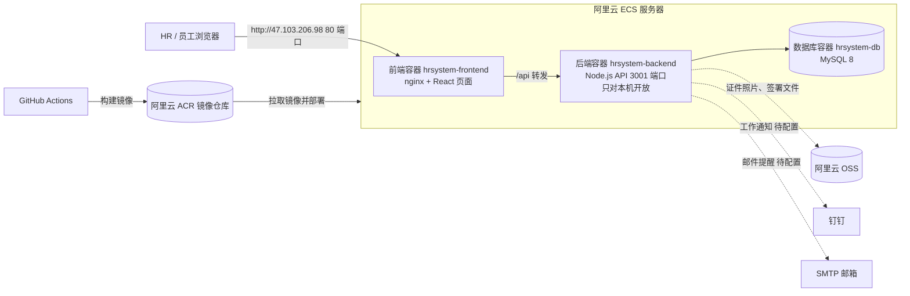
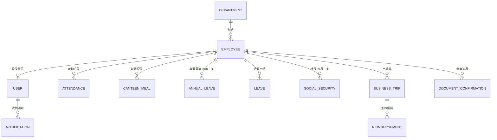
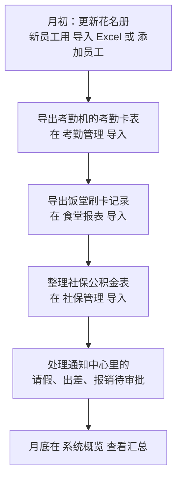
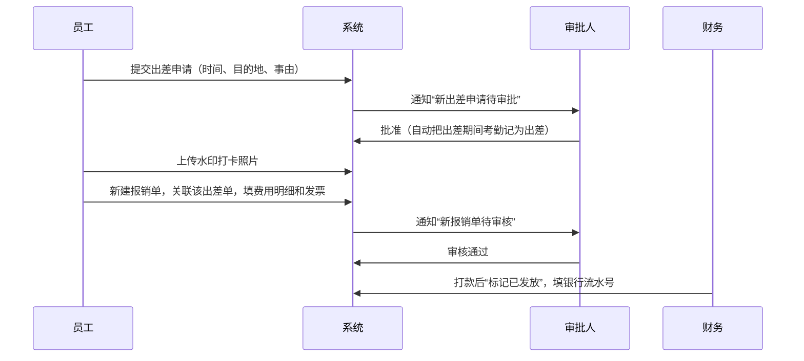

# 越祥生物科技人事管理平台 HR 使用手册

- 访问地址：http://47.103.206.98
- 适用对象：HR 管理员、超级管理员
- 版本：2026-10-21，对应部署 #76
- 本手册里的截图都来自正式环境的实际操作，样例数据以“测试员工QA（QA-0001）”为例

操作演示（系统概览、按工号查员工、员工详情、考勤、食堂、出差和报销详情）：

---

## 1. 系统能做什么

| 模块 | 用途 | 数据从哪里来 |
|------|------|------|
| 员工管理 | 员工档案、证件资料、在职状态 | 手工新增，或导入花名册 Excel |
| 部门管理 | 部门名称、编码、人数 | 手工维护；导入花名册时遇到新部门会自动建 |
| 考勤管理 | 迟到、早退、旷工、加班统计 | 导入考勤机导出的“考勤卡表”xls |
| 食堂报表 | 中餐、晚餐就餐人次 | 导入饭堂刷卡机导出的 xls |
| 年假管理 | 每人每年的应休、已休、结转、剩余 | 手工新增或 Excel 导入 |
| 请假管理 | 请假申请与审批 | 员工申请，或 HR 用 Excel 导入 |
| 社保管理 | 每月社保、公积金个人和公司缴纳 | Excel 导入 |
| 出差管理 | 出差申请、审批、水印打卡 | 提交申请，管理员审批 |
| 差旅报销 | 关联出差单报销，审核、发放 | 提交报销，审核后标记发放 |
| 制度确认 | 公司制度、培训承诺函、劳动合同的电子签署 | 员工阅读后签署，HR 查看状态 |
| 通知中心 | 待审批提醒 | 系统自动生成 |
| 综合报表 | 假期、考勤、入离职报表 | 汇总以上数据（当前版本有故障，见第 15 节） |
| 用户管理 | 账号、角色、数据范围、重置密码 | 超级管理员维护 |

### 角色

| 角色 | 能做什么 |
|------|------|
| 超级管理员（admin） | 全部功能，包括用户和权限 |
| HR 管理员（hr_admin） | 员工、部门、考勤、假期、社保、报表等人事功能 |
| 部门经理（department_manager） | 查看和审批本部门数据 |
| 财务（finance） | 报销审核与发放 |
| 员工（employee） | 自助服务：查看和完善个人信息、请假、出差、报销、签署制度 |

---

## 2. 系统架构

说明：

- HR 只需要用浏览器打开 http://47.103.206.98，不用安装任何软件
- 身份证号、手机号、银行卡、姓名在数据库里都是加密存储的，只有有权限的账号才能看到明文
- 每次开发人员合并代码后，通过 GitHub Actions 自动构建并部署到服务器，数据库数据不会被清空

---

## 3. 数据之间的关系

几条要记住的规则：

1. **先有员工，再有其他数据**。考勤、食堂、年假、社保、请假都挂在员工名下，所以每月先导花名册（或确认员工都已录入），再导其他表
2. **年假、社保、请假按“员工编号”匹配**，比如 RH-0001
3. **考勤卡表和食堂卡表按“姓名”匹配**，因为考勤机和饭卡机里没有公司编号。姓名和花名册对不上的人会在导入结果里列出来
4. **报销必须关联一张已批准的出差单**

---

## 4. 日常工作流程

### 4.1 每月例行工作

### 4.2 出差到报销

### 4.3 新员工入职

系统每天自动执行的提醒（需要配置钉钉或邮件后才会发出）：

| 时间 | 内容 |
|------|------|
| 每天 09:00 | 检查当天入职的员工，发送填表通知；检查 30 天内到期的劳动合同 |
| 每天 10:00 | 入职前 3 天提醒 |
| 每天 08:00 | 培训提醒 |
| 每周一 09:00 | 入职满一周的欢迎消息 |

---

## 5. 登录与修改密码

1. 打开 http://47.103.206.98，输入用户名和密码，点“登录”
2. 第一次登录，或管理员重置过密码后，系统会强制要求修改密码
3. 连续输错 5 次密码，账号会被锁 30 分钟

登录后默认进入“系统概览”：

> 提示：当前版本对每台电脑的访问次数有限制（15 分钟内 100 次请求）。如果页面突然全部加载失败、提示请求过多，等 8 到 15 分钟再试，并告诉开发人员（见第 15 节）。

---

## 6. 部门管理

**新增部门**：部门管理，点“添加部门”，填部门名称和部门编码（例如 技术部 / DEPT_05），点“创建”。编码不能重复。

**编辑**：点该行“编辑”，改完点“更新”。

**删除**：点“删除”，在确认框里点“确定”。删除不可恢复。

---

## 7. 员工管理

### 7.1 导入花名册（推荐）

适用于第一次建档，或批量新增员工。

1. 员工管理，点“导入 Excel”，选择花名册文件
2. 系统先显示**导入预览**：总行数、可导入数、有问题的行和原因
3. 确认无误后点“确认导入”

**样例**：导入 `花名册.xlsx`，105 行全部可导入：

导入完成：

**花名册格式要求**（直接用公司现有的“在职花名册”格式即可，第一行可以是标题）：

| 列名 | 必填 | 样例 | 说明 |
|------|------|------|------|
| 公司编号 | 是 | RH-0001 | 员工编号，不能重复 |
| 姓名 | 是 | 马达 | |
| 身份证号码 | 建议 | 320925197112246754 | 系统会加密保存 |
| 出生日期 | 否 | 19711224 | |
| 性别 | 否 | 男 | |
| 联系电话 | 建议 | 13651590963 | |
| 入职时间 | 建议 | 2006/10/1 | Excel 日期格式即可 |
| 部门 | 建议 | 销售部 | 部门不存在时会自动新建 |
| 岗位 | 否 | 销售经理 | |
| 状态 | 否 | 在职 | 填“离职”才会导入为离职，**空着默认在职** |

注意：

- 同一个工号再导一次会被跳过，并提示“员工编号已存在”：

  

- **离职花名册不要直接导入**。当前版本状态列为空时会当作在职，离职人员会被算进在职人数（见第 15 节）
- 部门名称要和系统里一致，比如系统里是“人事”，表里写“人事部”就会新建一个部门

### 7.2 手工新增员工

员工管理，点“添加员工”，带红色星号的是必填项：员工编号、姓名、性别、邮箱、入职日期、部门、职位、雇佣类型。保存后可以再上传身份证正反面、银行卡和毕业证书。

### 7.3 查找员工

在搜索框输入**员工编号**（如 RH-0001，可只输前几位）或**邮箱**，按回车。

当前版本**不支持按姓名搜索**（见第 15 节），可以按部门、状态、入职日期筛选后再找。

### 7.4 查看和编辑

点“查看”进入员工详情，可以看到基本信息、联系方式、就职信息、证件资料和制度签署状态；点“编辑信息”修改。

---

## 8. 考勤管理

1. 从考勤机导出“考勤卡表”（就是包含汇总表、排班信息、刷卡记录的那个 xls）
2. 考勤管理，点“导入考勤卡表”，选择文件
3. 等导入结果弹窗出来，看“匹配成功多少人”和“未匹配员工”名单

**样例**：导入 `考勤表贸易.xls`（2026-03-01 至 03-23），33 人中匹配 28 人，写入 644 条打卡记录：

导入后的统计和迟到、早退排行：

注意：

- **未匹配员工**是因为姓名不在花名册里（离职、劳务工或名字写法不同），他们的考勤不会入库。先在员工管理里补录，再重新导入
- 如果大量员工显示“旷工 16 天”但又有加班，通常是考勤机里这些人没有排班，需要先在考勤机里改排班再导出

---

## 9. 食堂报表

1. 从饭堂刷卡机导出 xls
2. 食堂报表，点“导入食堂卡表”，选择文件。文件较大时要等 20 秒左右
3. 看导入结果里的未匹配名单

**样例**：导入 `食堂.xls`（2026 年 2 月），写入 877 条就餐记录：

报表会显示中餐、晚餐总人次、每日和每周图表，以及每日、每周、每人汇总：

---

## 10. 年假管理

**手工添加**：年假管理，点“添加记录”，选员工（可搜工号）、年度，填应休天数、已休天数、结转天数。剩余天数自动计算：**剩余 = 应休 + 结转 - 已休**。

**样例**：QA-0001，2026 年，应休 5、已休 2、结转 1，剩余 4 天：

**批量导入**：点“下载模板”，按模板填写后点“导入 Excel”。模板列：员工编号、年度、应休天数、已休天数、结转天数、过期日期、备注。工号不存在的行会单独报错，不影响其他行：

---

## 11. 请假管理

**员工申请**：员工登录后在请假管理点“申请请假”，选类型（年假、病假、事假、调休、无薪假）、时间、天数和原因。

**HR 批量导入**：点“下载模板”，填写员工编号、请假类型、开始日期、结束日期、请假天数、请假原因、审批状态后导入。

**审批**：在列表里找到“待审批”的记录，点“批准”或“拒绝”。

> 注意：列表默认只显示开始日期在最近 30 天内的请假。**提前申请的请假要把筛选的结束日期往后调**才能看到（见第 15 节）。

---

## 12. 社保管理

1. 点“下载模板”，按员工编号和年月（如 2026-10）填写社保基数、公积金基数和各险种个人、公司金额，以及缴纳状态和日期
2. 点“导入 Excel”
3. 系统自动算出个人合计和公司合计

**样例**：QA-0001，2026-10，基数 5000，个人合计 = 养老 400 + 医疗 100 + 失业 25 + 公积金 600 = 1125；公司合计 = 800 + 500 + 50 + 工伤 40 + 生育 40 + 600 = 2030：

> 当前版本“添加记录”按钮不能用（会跳回系统概览），请先用导入方式录入。

---

## 13. 出差与差旅报销

### 13.1 出差申请

出差管理，点“新建出差申请”：选员工，填出差时间（精确到分钟）、目的地、事由。系统自动算出差总时长和计入工时（每天最多 8 小时，周末和节假日不计）。

审批人在详情页点“批准”。批准后系统会把出差期间的考勤记为“出差”，并要求员工上传水印打卡照片：

### 13.2 报销

差旅报销，点“新建报销单”：

1. 选择“关联出差单”（只能选已批准的），系统显示报销人和限额（住宿 ¥500/天，餐费 ¥150/天）
2. 点“添加费用明细”，选类别、发生日期、金额，上传发票
3. 点“提交审核”

审核人点“审核通过”，财务打款后点“标记已发放”并填写银行流水号：

**完整样例**：测试员工QA 10 月 23 日去盐城市区出差（BT202610210001），批准后报销长途交通 ¥88.50（RB202610210001），审核通过并发放。

---

## 14. 制度确认、通知与用户管理

**制度确认**：查看每位员工对“公司制度阅读确认表 / 培训服务承诺函 / 劳动合同”的签署状态。签署由员工本人登录后完成，需要读完全文才能签。

**通知中心**：右上角铃铛，或左侧菜单进入。有新的出差、报销待审批时会出现提醒；点“全部已读”清除。

**用户管理**（超级管理员）：查看账号、角色、数据范围和最后登录时间，可以编辑角色和重置密码。

---

## 15. 当前版本的已知问题

以下问题已经报给开发，修复前请按“临时办法”处理。完整清单见 [测试报告](../test-cases/README.md)。

| 问题 | 临时办法 |
|------|------|
| 综合报表的三个报表都打不开 | 暂时用考勤管理、食堂报表、请假管理页面里的统计 |
| 操作十几分钟后页面全部加载失败（请求过多） | 等 8 到 15 分钟再用，并告诉开发人员 |
| 出差详情里的时间和填写的不一样（差 8 小时） | 以通知中心和申请时填写的时间为准 |
| 离职花名册导入后会变成在职 | 不要导入离职表；离职员工在员工详情里修改状态 |
| 不能按姓名搜索员工 | 用员工编号搜索，或按部门筛选 |
| 员工的“工作地点”改了不保存 | 先写在“备注”里 |
| 社保“添加记录”按钮不能用 | 用 Excel 导入 |
| 提前申请的请假在列表里看不到 | 把筛选的结束日期往后调 |
| 通知全部已读后铃铛数字不变 | 刷新页面 |

---

## 16. 常见问题

**导入后有人“未匹配”怎么办？**
先在员工管理里确认这个人是否在职、姓名是否一致（多字、少字、同音字），补录或改正后重新导入同一个文件。已导入的记录会更新，不会重复。

**导入出错，是不是整个文件都没导？**
不是。有问题的行会被跳过并列出原因，其他行照常导入。

**员工的身份证号、手机号别人能看到吗？**
数据库里是加密的。只有有“查看敏感数据”权限的账号能看到完整号码，其他人看到的是打码后的号码。

**忘记密码怎么办？**
请超级管理员在用户管理里点“重置密码”。
